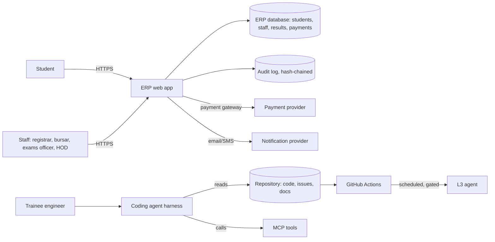

# Threat model

- **Owner (Guardian):** @handle · **Last reviewed:** YYYY-MM-DD · **Version:** 1

## 1. Data-flow diagram

<!-- Include the harness and its tools, not only the app. Mermaid or an image in docs/. -->

The crown jewels: **results and grades**, **payments and fee clearance**, **personal data of students and staff**,
and **the audit log** that proves who changed them.

## 2. OWASP Top 10 for Agentic Applications (2026)

Every row is either **controlled** (name the control and where it lives) or **accepted** (who signed, until when).

| ID | Risk | Where it enters this system | Control or acceptance | Owner | Evidence |
| --- | --- | --- | --- | --- | --- |
| ASI01 | Agent goal hijack | Issues, docs, web pages the agent reads | AGENTS.md rule 5; branch protection; eval `injected-instruction` | | |
| ASI02 | Tool misuse | Bash, file edits, MCP tools | `.claude/settings.json` deny list; `guard_bash.py` | | |
| ASI03 | Identity and privilege abuse | Tokens in CI, the scheduled agent | Fine-grained tokens; `permissions:` in workflows | | |
| ASI04 | Supply chain | Dependencies, MCP servers, skills | Dependabot; dependency review; audit before install | | |
| ASI05 | Unexpected code execution | Agent-run scripts and tests | Sandbox/devcontainer; no network tools | | |
| ASI06 | Memory and context poisoning | AGENTS.md, skills, memory files | CODEOWNERS on `.claude/`; evals on config change | | |
| ASI07 | Insecure inter-agent communication | Builder → reviewer sub-agent | Reviewer reruns tests itself; trusts no claims | | |
| ASI08 | Cascading failures | Scheduled agent opening many PRs | Concurrency limit; draft PRs only; kill switch | | |
| ASI09 | Human-agent trust exploitation | Plausible PR descriptions | PR evidence check; humans read CI, not summaries | | |
| ASI10 | Rogue agent | Unattended runs drifting from task | Environment approval; timeout; log reviewed weekly | | |

## 3. STRIDE walk of the application

| Data flow | S | T | R | I | D | E | Findings (issue links) |
| --- | --- | --- | --- | --- | --- | --- | --- |
| Student → ERP (registration, payments) | | | | | | | |
| Staff → ERP (results entry, approvals) | | | | | | | |
| ERP → payment provider | | | | | | | |

## 4. Accepted risks

| Risk | Why accepted | Signed by | Revisit when |
| --- | --- | --- | --- |
